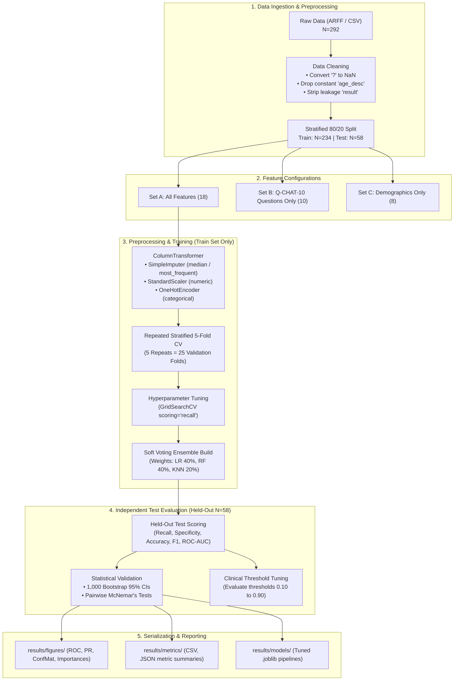

# ITM-390 ASD Screening Project: Architecture & Execution Guide

This document provides a comprehensive overview of how the **ITM-390 ASD Screening** machine learning project operates under the hood, and provides step-by-step instructions for environment configuration, training, evaluation, unit testing, and running interactive notebooks.

---

## Table of Contents
1. [Project Overview & Objectives](#1-project-overview--objectives)
2. [System Architecture & Workflow](#2-system-architecture--workflow)
3. [Methodological Highlights & Leakage Prevention](#3-methodological-highlights--leakage-prevention)
4. [Repository & Codebase Structure](#4-repository--codebase-structure)
5. [Environment Setup](#5-environment-setup)
6. [How to Train the Models (Automated Pipeline)](#6-how-to-train-the-models-automated-pipeline)
7. [How to Run Unit Tests](#7-how-to-run-unit-tests)
8. [How to Run Interactive Notebooks](#8-how-to-run-interactive-notebooks)
9. [Generated Artifacts & Output Results](#9-generated-artifacts--output-results)
10. [Troubleshooting & FAQs](#10-troubleshooting--faqs)

---

## 1. Project Overview & Objectives

* **Topic:** Comparative Analysis of Machine Learning Models for Autism Spectrum Disorder (ASD) Screening in Children.
* **Dataset:** UCI *Autism Spectrum Disorder Screening Data for Children* ($N = 292$ instances, 20 initial attributes).
* **Target Label:** `asd_target` (Binary classification: `1` = High risk / Positive ASD screen, `0` = Low risk / Negative ASD screen).
* **Clinical Focus (Screening vs. Diagnosis):** 
  Because this is an early **screening instrument** (not a diagnostic tool), a missed positive case (**False Negative**) delays critical early behavioral intervention. Therefore, the pipeline prioritizes **Recall / Sensitivity** as the primary optimization metric, while simultaneously evaluating Specificity, Precision, F1-Score, and ROC-AUC.

### Supervised Algorithms Evaluated
1. **Logistic Regression:** Interpretable linear baseline with L1/L2 regularization via `liblinear`.
2. **K-Nearest Neighbors (KNN):** Distance-based non-parametric classifier with odd-$K$ sweep ($K \in [3, 21]$).
3. **Random Forest:** Ensemble of decision trees optimizing Gini impurity/entropy with class weighting.
4. **Soft Voting Ensemble:** Blended weighted average of class probability estimates across all three base estimators.

---

## 2. System Architecture & Workflow

The project follows a modular, leak-free machine learning workflow:



---

## 3. Methodological Highlights & Leakage Prevention

1. **Target Leakage Elimination (`result` column):**  
   In the raw UCI dataset, the `result` column is the arithmetic sum of scores `A1_Score` to `A10_Score`. The target class was assigned deterministically whenever `result >= 7`. Leaving `result` in feature matrices produces 100% artificial accuracy. The pipeline drops `result` before splitting.
2. **Strict Preprocessor Encapsulation:**  
   The `ColumnTransformer` (imputation, scaling, one-hot encoding) is fit **only on training folds** during cross-validation, and **only on the training split** prior to test evaluation. This prevents test distributions from contaminating training parameters.
3. **Multi-Feature Set Validation:**  
   - **Set A (Primary):** All 10 Q-CHAT behavioral questions + 8 demographic features.
   - **Set B (Questions Only):** Behavioral screening scores $A_1$ through $A_{10}$.
   - **Set C (Demographics Only):** Control group proving that demographic variables alone drop performance to near-chance ($~53\text{--}55\%$ recall), proving the discriminative power stems from the behavioral questions.
4. **Repeated Cross-Validation & Bootstrap Uncertainty:**  
   Evaluates 25 cross-validation folds on training data and calculates **1,000-sample non-parametric bootstrap 95% confidence intervals** on held-out test data.

---

## 4. Repository & Codebase Structure

```
ITM-390-ASD-Screening/
├── .vscode/
│   ├── settings.json            # VS Code Python interpreter and pytest configuration
│   └── launch.json              # Debugging launcher profiles
├── data/
│   ├── raw/                     # Original UCI dataset (.arff, .csv, data_dictionary.md)
│   └── processed/               # Stratified 80/20 train/test CSV splits
├── src/
│   ├── __init__.py
│   ├── preprocessing.py         # Data cleaning, column definitions, ColumnTransformer
│   ├── models.py                # Estimator pipelines, hyperparameter grids, VotingClassifier
│   ├── evaluate.py              # Screening metrics, bootstrap CIs, McNemar test, plotting routines
│   └── utils.py                 # Reproducibility seeds, formatting helpers, JSON exporters
├── notebooks/
│   ├── 01_eda.ipynb             # Exploratory Data Analysis & target leakage proof
│   ├── 02_models.ipynb          # Model cross-validation, hyperparameter tuning & K-sweep
│   └── 03_evaluation.ipynb      # Final test set evaluation, ROC/PR curves & error profiling
├── tests/
│   ├── __init__.py
│   ├── test_preprocessing.py    # Unit tests for cleaning, leakage removal, pipeline transforms
│   └── test_evaluate.py         # Unit tests for metrics, bootstrap CI, McNemar tests
├── results/
│   ├── figures/                 # Generated high-resolution publication figures (PNG)
│   ├── metrics/                 # Exported CV and test evaluation metrics (CSV / JSON)
│   └── models/                  # Serialized trained models (.joblib)
├── docs/                        # Academic report, slides, and error analysis case study
├── requirements.txt             # Pinned package dependencies
├── pyproject.toml               # Project metadata and pytest configuration
├── main.py                      # Master orchestration execution script
└── README.md                    # Academic overview & benchmark results
```

---

## 5. Environment Setup

The repository is fully pre-configured for **VS Code** with a dedicated virtual environment (`.venv`).

### Verify Python and Virtual Environment
In the VS Code terminal (`Ctrl + ~` or `Terminal -> New Terminal`):

```powershell
# Verify the virtual environment python interpreter
.\.venv\Scripts\python --version
```
Expected output: `Python 3.11.x`

### (Optional) Fresh Setup or Reinstallation
If setting up on a new computer or clean environment:

```powershell
# Create virtual environment
python -m venv .venv

# Activate environment in PowerShell
.\.venv\Scripts\Activate.ps1

# Install required dependencies
pip install -r requirements.txt
```

> **Note for Windows PowerShell:** If you receive a script execution error (`PSSecurityException`), run:
> ```powershell
> Set-ExecutionPolicy -Scope Process -ExecutionPolicy Bypass
> ```
> then re-run `.\.venv\Scripts\Activate.ps1`.

---

## 6. How to Train the Models (Automated Pipeline)

The master script [`main.py`](file:///C:/Users/msi/Downloads/Fall%202026/ML/ITM-390-ASD-Screening/main.py) automates the entire experimental workflow in a single command.

### Run the Command
In the root directory of the project, run:

```powershell
python main.py
```
*(Or specify the interpreter explicitly: `.\.venv\Scripts\python.exe main.py`)*

### What Happens During Execution
When executed, `main.py` performs the following steps in sequence:
1. **Data Loading & Splitting:** Loads raw data from `data/raw/Autism-Child-Data.arff`, cleans values, drops the leaking `result` column, and creates/saves stratified 80/20 train/test splits in `data/processed/`.
2. **Feature Set Benchmark:** Runs Repeated Stratified 5-Fold Cross-Validation across Feature Sets A, B, and C.
3. **Hyperparameter Tuning:** Tunes Logistic Regression and Random Forest using `GridSearchCV(scoring='recall')`, and performs a KNN $K$-sweep ($K \in [3, 21]$).
4. **Ensemble Assembly:** Constructs the Soft Voting Classifier blending tuned Logistic Regression, KNN, and Random Forest.
5. **Model Serialization:** Saves all trained pipelines into `results/models/*.joblib`.
6. **Held-Out Test Set Evaluation:** Evaluates all 4 models on the untouched test split ($N = 58$) and prints a classification performance table.
7. **Bootstrap Uncertainty Analysis:** Computes 1,000 non-parametric bootstrap 95% confidence intervals for Recall, Specificity, Accuracy, Precision, and ROC-AUC.
8. **Statistical Significance Testing:** Computes pairwise McNemar tests (with continuity correction) between models.
9. **Decision Threshold Analysis:** Evaluates screening performance at varying classification cutoffs ($0.10$ to $0.90$).
10. **Figure Generation:** Generates and saves all publication plots to `results/figures/`.

*Total Execution Time: ~15 to 25 seconds on standard laptop CPU.*

---

## 7. How to Run Unit Tests

Automated testing ensures preprocessing integrity, leakage prevention, and mathematical correctness of metric calculators.

### Run All Unit Tests
Run `pytest` from the workspace root:

```powershell
pytest
```

For verbose output detailing each test:
```powershell
pytest -v
```

### With Code Coverage Report
```powershell
pytest --cov=src --cov-report=term-missing
```

### What the Unit Tests Check
* **`tests/test_preprocessing.py`**:
  * Confirms `result` and `age_desc` columns are stripped.
  * Verifies missing values (`?`) are correctly parsed to `np.nan`.
  * Verifies that `ColumnTransformer` transforms numeric and categorical columns properly.
  * **Critical:** Confirms zero data leakage between training and test partitions.
* **`tests/test_evaluate.py`**:
  * Validates metric calculation under perfect, imperfect, and edge-case (zero division) predictions.
  * Checks bootstrap confidence interval bounds ($0.0 \le \text{low} \le \text{high} \le 1.0$).
  * Verifies McNemar contingency matrix symmetry and significance calculations.
  * Tests threshold tuning probability bounds.

---

## 8. How to Run Interactive Notebooks

If you prefer exploring the methodology step-by-step or visualizing intermediate data:

### In VS Code (Recommended)
1. In the VS Code file explorer, expand the [`notebooks/`](file:///C:/Users/msi/Downloads/Fall%202026/ML/ITM-390-ASD-Screening/notebooks/) folder.
2. Click on any notebook:
   * **`01_eda.ipynb`**: Exploratory Data Analysis, missingness analysis, class distributions, and empirical proof of target leakage.
   * **`02_models.ipynb`**: Pipeline architectures, Repeated 5-Fold Cross-Validation, KNN $K$-parameter sweep, and ensemble construction.
   * **`03_evaluation.ipynb`**: Held-out test evaluation, ROC/PR curves, confusion matrices, decision threshold curves, and False Negative error profiling.
3. In the top-right corner of the notebook editor, click **Select Kernel** $\rightarrow$ **Python Environments...** $\rightarrow$ select the `.venv` interpreter (`.venv\Scripts\python.exe`).
4. Execute cells interactively using `Shift + Enter` or click **Run All**.

### In Jupyter Lab (Browser)
Alternatively, launch a local Jupyter server:
```powershell
jupyter lab
```

---

## 9. Generated Artifacts & Output Results

After running `python main.py`, the following output files are updated in `results/`:

### Figures (`results/figures/`)
* **`combined_roc_curves.png`**: Multi-model ROC curves with AUC comparisons.
* **`combined_pr_curves.png`**: Precision-Recall curves indicating performance on the minority class.
* **`confusion_matrices.png`**: Side-by-side confusion matrices highlighting False Negatives vs False Positives.
* **`knn_k_sweep.png`**: Training vs cross-validation recall across neighbor values $K \in [3, 21]$.
* **`feature_importance_comparison.png`**: Random Forest Gini importances vs Logistic Regression standardized odds ratios.
* **`threshold_curves_*.png`**: Sensitivity/Specificity trade-off curves across probability thresholds ($0.10 \le \tau \le 0.90$).

### Metrics (`results/metrics/`)
* **`cv_metrics_feature_sets.csv`**: Cross-validation results comparing Feature Sets A, B, and C.
* **`test_metrics.csv` & `test_metrics.json`**: Primary evaluation metrics on held-out test data.
* **`bootstrap_ci.csv`**: 95% bootstrap confidence intervals for all models.
* **`mcnemar_tests.csv`**: Pairwise contingency tables and McNemar $\chi^2$ / $p$-values.
* **`threshold_analysis_*.csv`**: Detailed metrics at each cutoff threshold.

### Serialized Models (`results/models/`)
* `logistic_regression_best.joblib`
* `knn_best.joblib`
* `random_forest_best.joblib`
* `voting_ensemble_best.joblib`

---

## 10. Troubleshooting & FAQs

### Q: Why run in VS Code instead of Google Colab?
* **Zero GPU Benefit:** The dataset is tabular ($N = 292$), and `scikit-learn` models run on CPU. The full run completes in ~15 seconds locally.
* **No Path / Disconnect Issues:** Colab frequently disconnects and requires re-uploading files or mounting Google Drive. Local VS Code keeps your environment, Git history, and output figures persistent.

### Q: `ModuleNotFoundError: No module named 'src'`
* **Cause:** Running python from a subfolder rather than the project root.
* **Solution:** Always run commands from the project root (`ITM-390-ASD-Screening/`). If running in a notebook, ensure the top cell executes `sys.path.append(str(project_root))`.

### Q: VS Code notebook kernel does not find installed libraries
* **Solution:** Click **Select Kernel** in the top right of the notebook $\rightarrow$ **Python Environments...** $\rightarrow$ select `.venv\Scripts\python.exe`.

### Q: How do I change the classification decision threshold?
* In [`src/evaluate.py`](file:///C:/Users/msi/Downloads/Fall%202026/ML/ITM-390-ASD-Screening/src/evaluate.py), predictions can be generated via `(y_proba >= threshold).astype(int)`. Lowering the threshold (e.g., from $0.50$ to $0.35$) increases Recall/Sensitivity (fewer False Negatives) at the cost of Specificity.
